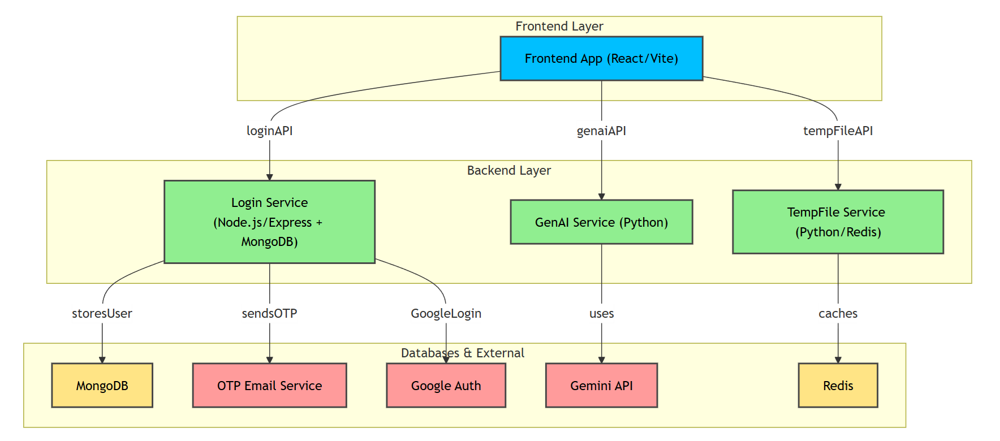
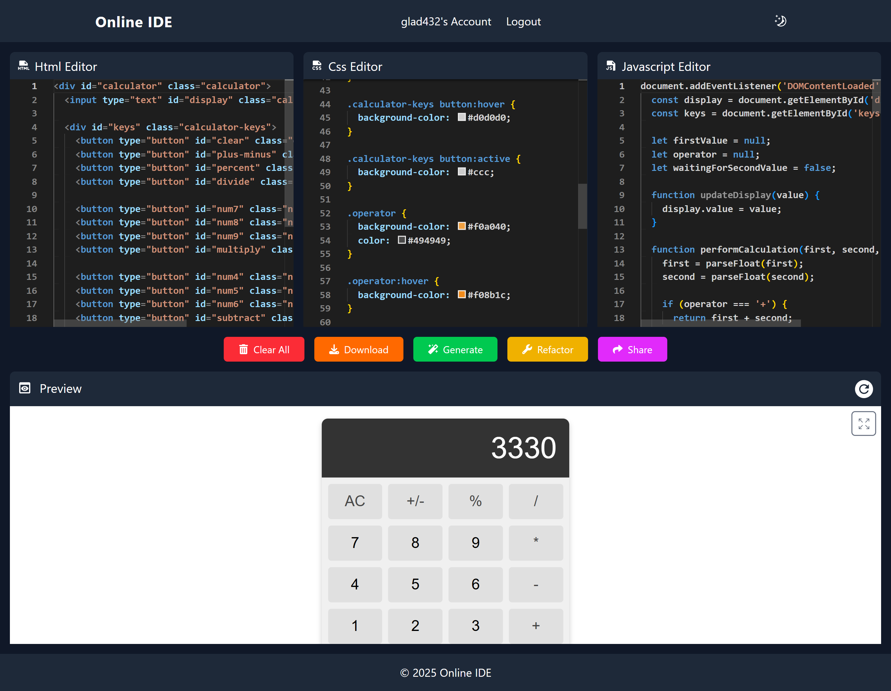
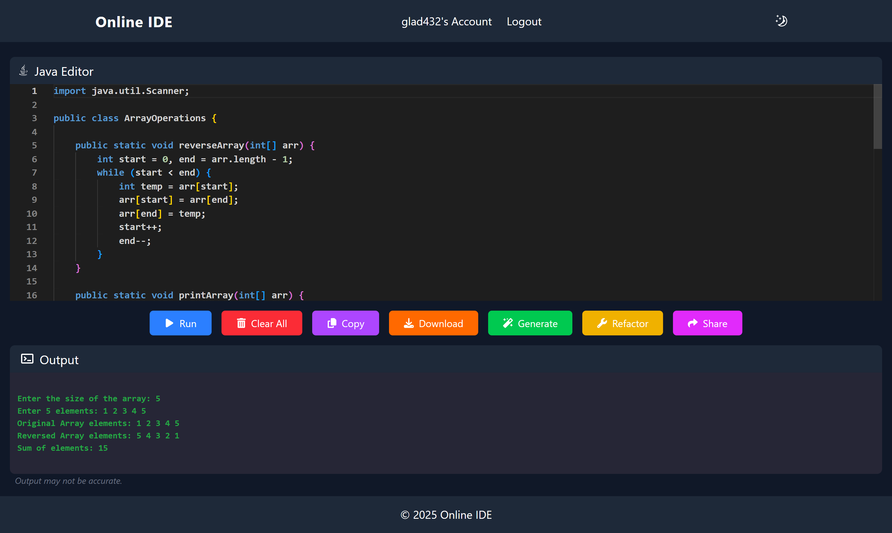
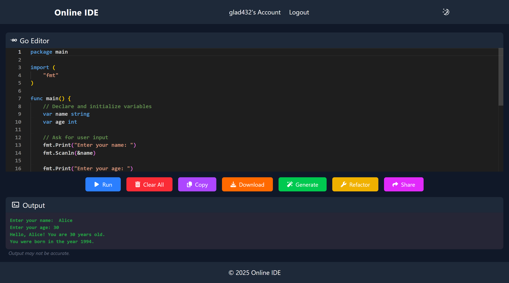
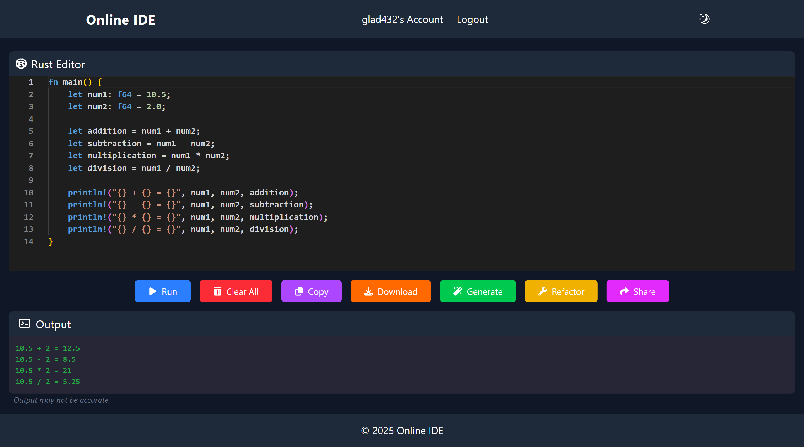
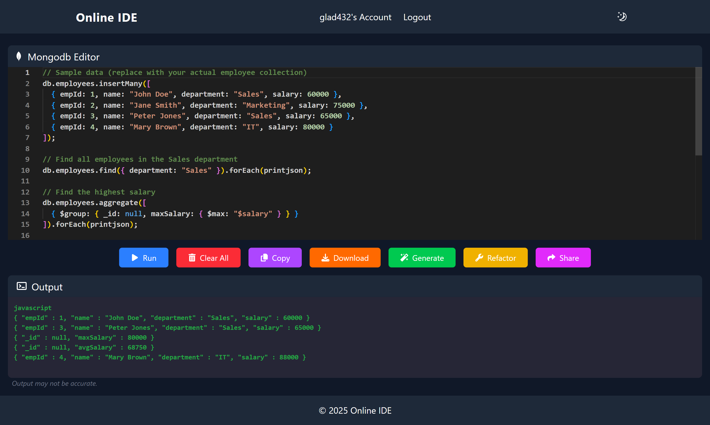
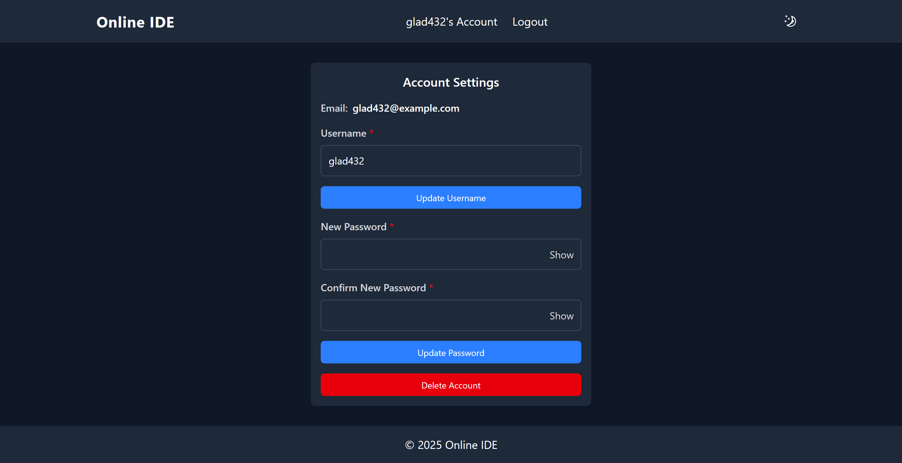
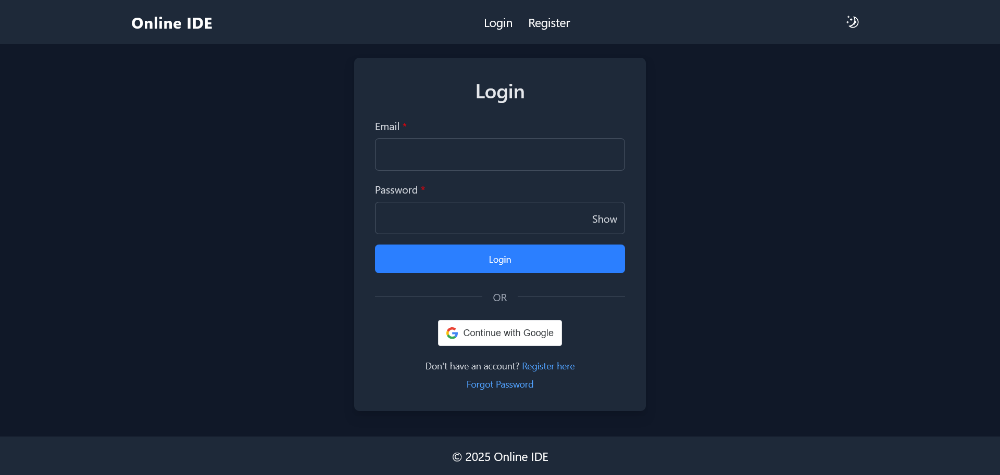

# 💻 Online IDE

[](LICENSE)
[](https://vitejs.dev/)
[](https://nodejs.org/)
[](https://www.python.org/)
[](https://microsoft.github.io/monaco-editor/)
[](https://ai.google.dev/)

An advanced, full-stack **Online Cloud IDE** featuring an integrated **Monaco Editor**, multi-language code execution, AI-powered code assistance (generation, explanation, refactoring), secure user authentication with OTP & Google OAuth, bot protection, and snippet sharing.

---

## 📸 Overview & Architecture


### System Architecture Diagram


---

## ✨ Features

- ⚡ **Multi-Language Monaco Editor**: Syntax highlighting, autocomplete, code folding, bracket matching, and theme customization for 20+ programming languages.
- 🌐 **Interactive Web Playground**: Real-time live preview for HTML, CSS, and JavaScript.
- 🤖 **AI Assistant (Google Gemini)**: Generate new code snippets, explain complex algorithms, and refactor existing code with real-time streaming responses.
- 🔒 **Comprehensive Authentication**:
  - Email & Password registration with OTP email verification (Nodemailer).
  - One-click Google OAuth 2.0 sign-in.
  - Password strength verification (HaveIBeenPwned API integration).
  - Rate limiting & anti-abuse via Cloudflare Turnstile & Google reCAPTCHA v3.
- 🔗 **Snippet Sharing & Temp Files**: Generate shareable code links and manage temporary files with Redis caching.
- 👤 **User Dashboard & Analytics**: Track usage stats, manage shared links, update account profiles, and change security credentials.

---

## 🛠️ Tech Stack & Dependencies

### Frontend
- **Framework & Bundler**: [React](https://reactjs.org/) + [Vite](https://vitejs.dev/)
- **Code Editor**: [Monaco Editor](https://microsoft.github.io/monaco-editor/)
- **Styling**: [Tailwind CSS](https://tailwindcss.com/), [Tailwindcss-motion](https://github.com/romboHQ/tailwindcss-motion), [Sass](https://sass-lang.com/)
- **Routing**: [React Router](https://reactrouter.com/)
- **Authentication & Security**: [@react-oauth/google](https://www.npmjs.com/package/@react-oauth/google), [Cloudflare Turnstile](https://www.npmjs.com/package/@marsidev/react-turnstile), [Google reCAPTCHA v3](https://www.npmjs.com/package/react-google-recaptcha-v3)
- **UI Alerts**: [SweetAlert2](https://sweetalert2.github.io/)

### Backend Services

| Service | Directory | Tech Stack | Port | Purpose |
|---|---|---|---|---|
| **Auth & Account Service** | `Backend/Login` | Node.js, Express, MongoDB (Mongoose), Redis | `5000` | Auth, OTP, User profile, Shared links, Rate limiting |
| **AI Assistant Service** | `Backend/Genai` | Python 3, Flask, Google Gemini SDK, Redis | `5001` | AI code generation, code explanation, refactoring |
| **Temporary File Service** | `Backend/TempFile` | Python 3, Flask, Redis | `5002` | Temporary file storage, secure retrieval, file downloads |
| **Web Client** | `Frontend` | React 18, Vite, Tailwind CSS | `5173` | Interactive user interface and code editor |

---

## 🗂️ Project Structure

```text
online-ide/
├── Backend/
│   ├── Genai/           # Python Flask service for Google Gemini AI features
│   ├── Login/           # Express/Node.js service for Auth, MongoDB & Accounts
│   └── TempFile/        # Python Flask service for temporary code file storage
├── Frontend/            # React + Vite + Tailwind CSS web application
│   ├── public/          # Static assets & headers
│   └── src/
│       ├── components/  # CodeEditor, Editor, Header, Footer, Navigation
│       ├── pages/       # Login, Register, Accounts, ForgotPassword
│       ├── samples/     # Starter code templates for each language
│       └── utils/       # API fetchers, modal handlers, security wrappers
├── Images/              # UI screenshots and architecture diagram
├── .gitignore
├── LICENSE
└── README.md
```

---

## 🚀 Getting Started

### Prerequisites

Ensure you have the following installed on your machine:
- [Node.js](https://nodejs.org/) (v18.x or higher) & [npm](https://www.npmjs.com/)
- [Python](https://www.python.org/) (v3.9 or higher) & [pip](https://pip.pypa.io/)
- [MongoDB](https://www.mongodb.com/) (Local or MongoDB Atlas connection)
- [Redis](https://redis.io/) (Local or Upstash Redis instance)
- [Git](https://git-scm.com/)

---

### Step 1: Clone the Repository

```bash
git clone https://github.com/Durgeshbagul29/Online-ide.git
cd Online-ide
```

---

### Step 2: Configure Environment Variables

Each subproject has an `.env.example` file. Create `.env` copies and fill in your credentials:

#### 1. Backend Login (`Backend/Login/.env`)
```bash
cp Backend/Login/.env.example Backend/Login/.env
```
Key configuration settings:
- `MONGO_URI`: Your MongoDB database connection string.
- `JWT_SECRET`: Secret key for signing authentication tokens.
- `GOOGLE_CLIENT_ID`: Google OAuth client ID.
- `RECAPTCHA_SECRET_KEY`: Google reCAPTCHA v3 secret key.
- `TURNSTILE_SECRET_KEY`: Cloudflare Turnstile secret key.
- `OTP_EMAIL_USER` & `OTP_EMAIL_PASS`: SMTP credentials for OTP emails.
- `REDIS_URL` & `REDIS_PASSWORD`: Redis connection details.
- `FRONTEND_URL`: URL of the frontend (e.g. `http://localhost:5173`).
- `PORT`: `5000`

#### 2. Backend GenAI (`Backend/Genai/.env`)
```bash
cp Backend/Genai/.env.example Backend/Genai/.env
```
Key configuration settings:
- `GOOGLE_API_KEY`: Google Gemini API key.
- `GEMINI_MODEL`: e.g. `gemini-1.5-flash` or `gemini-1.5-pro`.
- `JWT_SECRET`: Same JWT secret as the Login backend.
- `REDIS_HOST`, `REDIS_PORT`, `REDIS_PASSWORD`: Redis credentials.
- `ALLOWED_ORIGINS`: `http://localhost:5173`
- `PORT`: `5001`

#### 3. Backend TempFile (`Backend/TempFile/.env`)
```bash
cp Backend/TempFile/.env.example Backend/TempFile/.env
```
Key configuration settings:
- `REDIS_HOST`, `REDIS_PORT`, `REDIS_PASSWORD`: Redis credentials.
- `JWT_SECRET`: Shared JWT secret.
- `TEMP_FILE_URL`: Base download/sharing URL.
- `ALLOWED_ORIGINS`: `http://localhost:5173`
- `PORT`: `5002`

#### 4. Frontend (`Frontend/.env`)
```bash
cp Frontend/.env.example Frontend/.env
```
Key configuration settings:
- `VITE_BACKEND_API_URL=http://localhost:5000`
- `VITE_GEMINI_API_URL=http://localhost:5001`
- `VITE_TEMP_SHARE_URL=http://localhost:5002`
- `VITE_GOOGLE_CLIENT_ID`: Your Google OAuth Client ID
- `VITE_RECAPTCHA_SITE_KEY`: Your Google reCAPTCHA v3 Site Key
- `VITE_TURNSTILE_SITE_KEY`: Your Cloudflare Turnstile Site Key

---

### Step 3: Install Dependencies & Run

#### 1. Authentication Service
```bash
cd Backend/Login
npm install
node server.js
```
*Runs on `http://localhost:5000`*

#### 2. AI Code Generation Service
```bash
cd Backend/Genai
pip install -r requirements.txt
python app.py
```
*Runs on `http://localhost:5001`*

#### 3. Temporary File Service
```bash
cd Backend/TempFile
pip install -r requirements.txt
python app.py
```
*Runs on `http://localhost:5002`*

#### 4. Frontend Application
```bash
cd Frontend
npm install
npm run dev
```
*Runs on `http://localhost:5173`*

Open [http://localhost:5173](http://localhost:5173) in your browser to start coding!

---

## 🖼️ Screenshots

<details>
<summary><b>Click to expand full screenshots gallery</b></summary>
<br>

| View | Screenshot |
|---|---|
| **Web Preview (HTML / CSS / JS)** |  |
| **Python** |  |
| **JavaScript** |  |
| **TypeScript** |  |
| **C / C++** |  |
| **Java** |  |
| **Go** |  |
| **Rust** |  |
| **SQL & Database** |  |
| **MongoDB** |  |
| **User Dashboard** |  |
| **Authentication Flow** |  |

</details>

---

## 👨‍💻 Author & Maintainer

Developed and maintained by **Durgesh Bagul** under **BSquare Softwares**.

---

## 📄 License

This project is licensed under the BSquare Softwares License. See the [LICENSE](LICENSE) file for more details.